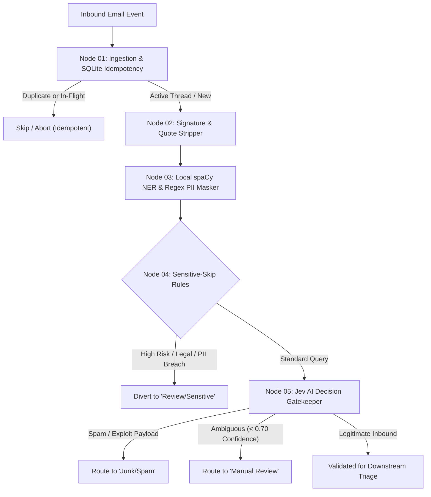
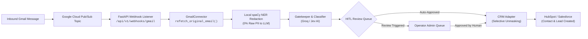

# Customer Email Triage Automation

A local-first, privacy-preserving automated email triage pipeline built on **LangGraph**. The system intercepts incoming customer inquiries, deduplicates and tracks processing state via an idempotent SQLite store, strips email signatures and thread history, locally sanitizes PII, applies sensitive guardrail diversions, and evaluates inbound traffic using **Jev AI** decision intelligence.

**Phase 2** extends this foundation with deep 10-category semantic classification, emotional escalation detection, Human-in-the-Loop review gating ([docs/hitl_runbook.md](./docs/hitl_runbook.md)), multi-destination dispatching (GitHub Issues, FreeScout Support, HubSpot CRM, Webhooks), and an autonomous background queue worker ([docs/architecture_phase2.md](./docs/architecture_phase2.md)).

For current deliverable tracking and project milestones, refer to the [**Project Roadmap**](./ROADMAP.md).

---

## 🏛️ Pipeline Architecture



---

## 🔑 Core System Components

### 1. Ingestion & Idempotency Store (Node 01)
* **Crash-Resilient State Machine:** Utilizes SQLite with three atomic states (`processing`, `done`, `failed`).
* **Stale Lock Recovery:** In-flight tasks exceeding 10 minutes without completion are automatically recovered with incremented retry counters.
* **Active Thread Verification:** Detects ongoing threads and verifies that the inbound sender is a known participant of prior messages in the thread.
* **Phase 2 Hand-off Contract:** Phase 2 picks up rows with `routing_status='gatekeeper_approved'` (or via `db.get_gatekeeper_approved()`), reads `masked_subject` and `masked_body` directly from the row, and `token_map` is deliberately not stored (Phase 2 must re-fetch originals from the mailbox by `message_id` if a destination needs unmasked text). Marking them as `status = 'done'` guarantees immediate retransmissions within 10 minutes are recognized as duplicates without blocking Phase 2 downstream execution.

### 2. Privacy & Noise Stripping (Node 02)
* **Quote Truncation:** Strips nested email replies (`On <date> ... wrote:`, `-----Original Message-----`, Outlook header dividers).
* **Signature & Disclaimer Removal:** Cleans RFC 3676 delimiters (`-- `), sign-offs (`Best regards`, `Thanks`), mobile footers (`Sent from my iPhone`), and corporate legal disclaimers.
* **Safety Fallback:** Preserves blockquoted error logs and prevents blank body states.

### 3. Local PII Redaction (Node 03)
* **Zero External Leakage:** Runs 100% locally via spaCy NER (`en_core_web_sm`) and compiled regexes on CPU.
* **Bi-directional Token Mapping:** Converts customer names, emails, phone numbers, and credentials to anonymous tokens (`[PERSON_1]`, `[EMAIL_1]`) prior to any third-party network egress.

### 4. Sensitive Guardrails & Diversion (Node 04)
* **Rule-Based Diversion:** Intercepts sensitive legal, regulatory, or account security queries before LLM ingestion.
* **Human-in-the-Loop Quarantine:** Routes matching emails directly to the human review queue.

### 5. Jev AI Decision Gatekeeper (Node 05)
* **Primary Classifier:** Low-latency threat and spam classification powered by TypeSafe System One (Jev `jev-1.13.0`) with local heuristic fallback (average offline pipeline throughput ~27ms/email).
* **High Availability Fallback:** Automatic failover to Groq (`openai/gpt-oss-20b`) and deterministic regex heuristics.
* **Tri-State Routing:** Labels items as `legitimate`, `spam`, or `manual_review`.

#### 🚀 Enabling TypeSafe System One (Jev)
To evaluate incoming inquiries with live AI:
1. **Recommended First Step — One-Call Connectivity Smoke Test:**
   Always verify connectivity and API key validity with a single isolated test call before running full batches:
   ```bash
   python scripts/jev_smoke_test.py
   ```
   *(Or inside Docker: `docker compose run --rm email-triage python scripts/jev_smoke_test.py`)*

2. **Full Benchmark Evaluation (`--live`):**
   ```bash
   python main.py --live
   ```
   *(Or inside Docker: `docker compose run --rm email-triage python main.py --live`)*

   > [!WARNING]
   > Running `python main.py --live` transmits all 100 benchmark emails to the live external APIs (generating roughly 100 to 200 external network calls, incurring real API usage costs, and potentially triggering Groq free-tier 429 rate limits). Furthermore, several benchmark scenario expectations in `data/benchmark_emails.json` are calibrated against offline heuristic baselines and live AI decisions may legitimately vary.

*(Note: Without a real key or with placeholder credentials, the pipeline runs in offline mode using the local heuristic fallback).*

---

## 📁 Repository Structure

```
Customer-Email-Triage-Automation/
├── .dockerignore              # Docker build exclusions
├── .env.example              # Environment variables template
├── .gitignore                # Git repository ignore rules
├── AGENTS.md                 # Operating rules, invariants, and guardrails for AI agents
├── check.sh                  # All-in-one testing, linting, and egress verification script
├── config/
│   └── tech_terms.txt        # Two-tier technical terms whitelist (unambiguous / ambiguous)
├── config.yaml               # Central system and threshold configuration
├── Dockerfile                # Production container specification
├── docker-compose.yml        # Multi-container orchestration
├── docs/
│   ├── ARCHITECTURE.md       # Pipeline architecture, state map, database schema, & config reference
│   ├── architecture_phase2.md# Phase 2 technical reference, state machine, & diagrams
│   ├── contracts/            # External API contract specifications
│   ├── hitl_runbook.md       # Operator runbook for human review queue & reconciliation
│   └── phase2_decisions.md   # Architectural decisions for Phase 2
├── GEMINI.md -> AGENTS.md    # Agent instructions symlink
├── main.py                   # Production entry point and CLI benchmark runner
├── pipeline.py               # LangGraph compiled pipeline orchestrator
├── prompts.py                # Classifier LLM system and user prompt templates
├── pyproject.toml            # Development tool configurations (ruff, mypy, bandit, pytest)
├── README.md                 # Project documentation and quickstart guide
├── requirements.txt          # Pinned runtime production dependencies
├── requirements-dev.txt      # Pinned development and testing dependencies
├── ROADMAP.md                # 24-point senior review remediation roadmap
├── state.py                  # LangGraph TriageState & Pydantic models
├── data/
│   ├── benchmark_emails.json # 100-scenario Phase 1 synthetic benchmark dataset
│   ├── benchmark_phase2.json # 50-scenario Phase 2 multi-destination benchmark dataset
│   ├── sample_email.json     # Sample legitimate email payload
│   └── sample_email_spam.json# Sample spam email payload
├── db/
│   └── database.py           # SQLite idempotency engine
├── nodes/
│   ├── ingest.py             # Node 01: Ingestion and idempotency
│   ├── signature_stripper.py # Node 02: Quote and signature removal
│   ├── pii_masker.py         # Node 03: Local spaCy & regex redaction
│   ├── sensitive_skip.py     # Node 04: Sensitive guardrail diversion
│   ├── jev_gatekeeper.py     # Node 05: Jev AI decision engine
│   ├── classifier.py         # Node 06: Phase 2 category & priority classifier
│   ├── hitl_queue.py         # Node 07: Phase 2 human-in-the-loop review queue
│   └── dispatcher.py         # Node 08: Phase 2 outbound routing & adapter execution
├── scripts/
│   ├── build_e2e_case_artifacts.py # Generates live e2e test cases & markdown audit reports
│   ├── crm_smoke_test.py     # Sandbox smoke test for HubSpot CRM adapter
│   ├── freescout_smoke_test.py # Sandbox smoke test for FreeScout helpdesk adapter
│   ├── github_smoke_test.py  # Sandbox smoke test for GitHub Issues adapter
│   ├── hitl_cli.py           # Reviewer CLI interface for HITL queue management
│   ├── jev_smoke_test.py     # Standalone TypeSafe System One connectivity smoke test
│   ├── manual_classifier_check.py # Offline classifier verification script
│   ├── phase2_worker.py      # Autonomous background queue worker daemon
│   ├── renew_mailbox_watch.py# Gmail Cloud Pub/Sub watch setup and 7-day renewal CLI
│   └── webhook_smoke_test.py # Sandbox smoke test for Slack/Generic webhook adapter
├── test/ -> tests/e2e_pipeline_cases # Direct symlink for test case exploration
├── test_cases/ -> tests/e2e_pipeline_cases # Showcase test cases for client demo
├── tests/                    # Comprehensive unit and integration test suite (703 tests)
│   ├── conftest.py           # Test isolation fixtures & network egress guards
│   ├── e2e_pipeline_cases/   # 6 end-to-end showcase test folders with full traces
│   │   ├── 01_github_issue/  # GitHub bug report case (500 Internal Server Error)
│   │   ├── 02_crm_lead/      # HubSpot CRM sales lead case (350-seat demo)
│   │   ├── 03_freescout_ticket/ # FreeScout helpdesk support ticket case
│   │   ├── 04_webhook_alert/ # Urgent duplicate invoice charge & HITL review case
│   │   ├── 05_malware_threat/# Adversarial DAN prompt injection jailbreak case
│   │   └── 06_security_vulnerability/ # Security session token leak disclosure case
│   ├── test_a12_container_security.py
│   ├── test_a14_dependency_pinning.py
│   ├── test_architecture_doc.py
│   ├── test_benchmark_runner.py
│   ├── test_c2_isolation.py
│   ├── test_c3_smoke_test.py
│   ├── test_fix_b4_state_db_sync.py
│   ├── test_fix_b5_config.py
│   ├── test_fix_b6_lifecycle.py
│   ├── test_ingest_idempotency.py
│   ├── test_jev_client.py
│   ├── test_jev_gatekeeper.py
│   ├── test_main.py
│   ├── test_no_stale_claims.py
│   ├── test_p2_adapter_contracts.py
│   ├── test_p2_benchmark.py
│   ├── test_p2_classifier.py
│   ├── test_p2_crm_adapter.py
│   ├── test_p2_crm_format.py
│   ├── test_p2_dispatch_foundations.py
│   ├── test_p2_dispatcher.py
│   ├── test_p2_documentation.py
│   ├── test_p2_egress.py
│   ├── test_p2_failure_injection.py
│   ├── test_p2_freescout_adapter.py
│   ├── test_p2_freescout_format.py
│   ├── test_p2_github_adapter.py
│   ├── test_p2_github_format.py
│   ├── test_p2_hitl.py
│   ├── test_p2_mailbox_connector.py
│   ├── test_p2_pipeline_e2e.py
│   ├── test_p2_unmasker.py
│   ├── test_p2_webhook_adapter.py
│   ├── test_p2_webhook_format.py
│   ├── test_p2_worker.py
│   ├── test_pii_masker.py
│   ├── test_pipeline_e2e.py  # End-to-end integration and benchmark tests
│   ├── test_readme_metrics.py
│   ├── test_sensitive_skip.py
│   └── test_signature_stripper.py
├── tools/
│   ├── check_concurrency.py  # Multiprocess / multithread concurrency verification
│   ├── egress_check.py       # Zero-network-leak verification tool
│   └── run_worker.sh         # Daemon wrapper script with automatic restart
└── utils/
    ├── adapters/             # Outbound destination adapters (GitHub, FreeScout, CRM, Webhook)
    ├── classifier_client.py  # Multi-tier classifier client (Jev AI & Groq fallback)
    ├── config.py             # Environment and config loader
    ├── jev_client.py         # Jev AI client with fallback handler
    ├── mailbox/              # Gmail connector with Pub/Sub watch and MIME parser
    ├── text_tools.py         # Bounded text scanning & normalization helpers
    └── unmasker.py           # Universal Selective Unmasking engine
```

---

## 🐳 Complete Guide: Running in Docker on Any Computer

This project is fully containerized. You can run it on **any computer in the world** (Linux, macOS, or Windows) without needing to configure local Python versions or spaCy C-compilers.

### 1. Prerequisites (Cross-Platform)

Ensure your machine has **Docker** and **Docker Compose** installed:

| Operating System | Recommended Installation | Notes |
|:---|:---|:---|
| **Windows 10/11** | [Docker Desktop for Windows](https://docs.docker.com/desktop/setup/install/windows-install/) | Use the **WSL 2 backend** (enabled by default). |
| **macOS (Intel & Apple Silicon M1/M2/M3)** | [Docker Desktop for Mac](https://docs.docker.com/desktop/setup/install/mac-install/) | Works natively on both ARM64 and x86_64 architectures. |
| **Linux (Ubuntu, Debian, Fedora, Arch)** | [Docker Engine](https://docs.docker.com/engine/install/) + `docker-compose-plugin` | Ensure non-root access: `sudo usermod -aG docker $USER`. |

Verify your installation in your terminal / command prompt:
```bash
docker --version
docker compose version
```

---

### 2. Step-by-Step Setup & Execution

#### Step 1: Clone the Repository
Open a terminal (or PowerShell / Git Bash on Windows) and run:
```bash
git clone https://github.com/<your-org>/Customer-Email-Triage-Automation.git
cd Customer-Email-Triage-Automation
```

#### Step 2: Configure Environment Variables
Copy the template configuration file to `.env`:

* **Linux / macOS / Git Bash:**
  ```bash
  cp .env.example .env
  ```
* **Windows (PowerShell):**
  ```powershell
  Copy-Item .env.example .env
  ```
* **Windows (Command Prompt):**
  ```cmd
  copy .env.example .env
  ```

Open `.env` in any text editor and fill in your API credentials (e.g., `JEV_API_KEY`, `GROQ_API_KEY`).

##### Environment Variable Overrides & Precedence
The application enforces a fail-fast configuration model. Runtime system parameters can be overridden via environment variables with strict precedence (`env > config.yaml`):

| Variable | Target Config Key | Type | Description |
|---|---|---|---|
| `DATABASE_PATH` | `system.database_path` | String | Path to persistent SQLite idempotency database |
| `IDEMPOTENCY_STALE_MINUTES` | `system.idempotency_stale_minutes` | Integer (`> 0`) | Stale lock recovery window before in-progress emails are recovered |
| `MAX_DISPATCH_RETRIES` | `system.max_dispatch_retries` | Integer (`>= 0`) | Maximum retry attempts permitted for stale or failed emails |

If an override variable is unset or empty, the value defined in `config.yaml` is used. If an invalid value is supplied, the application fails fast at startup with exit code `2` naming the invalid variable without leaking environment secrets.

#### Step 3: Build the Docker Image
Build the container. By default, this installs all production and development dependencies (including `pytest`) and downloads the local spaCy NER model (`en_core_web_sm`):
```bash
docker compose build
```

> **Slim Image Build:** To create a slim image without testing dependencies, specify `WITH_TESTS=false`:
> ```bash
> docker compose build --build-arg WITH_TESTS=false
> ```
> *(Tip: If dependencies change in the future, rebuild with `docker compose build --no-cache`).*

#### Step 4: Run the Application
Phase 1 operates as a batch execution pipeline rather than an always-on background listener.

To execute the 100-scenario benchmark suite once and exit:
```bash
docker compose up
```

To process a single email payload once and exit:
```bash
docker compose run --rm email-triage python main.py --input data/sample_email.json --offline
```

#### Step 5: Run Automated Tests Inside Docker
You can execute the entire test suite inside the exact container runtime environment on any machine without installing Python locally:
```bash
docker compose run --rm email-triage pytest tests/ -v
```

#### Step 6: Interactive Terminal / Debugging
If you need to enter the container environment to inspect SQLite data or files:
```bash
docker compose run --rm email-triage bash
```

---

### 3. Data Persistence & Volume Mounts

The container uses a dedicated data volume mount defined in `docker-compose.yml`:
* **Persistent SQLite Database:** `./data:/app/data` stores the SQLite idempotency database file (`data/triage.db`). The host repository source code is not mounted into `/app`, ensuring container immutability and preventing host filesystem modification.
* Even if the container is deleted or rebuilt, **all processing history and idempotency locks remain safely persisted on your host machine**.

---

### 4. Essential Docker Commands

| Action | Command |
|:---|:---|
| **Run Offline Benchmark (100 Scenarios)** | `docker compose up` |
| **Process Single Email Payload** | `docker compose run --rm email-triage python main.py --input data/sample_email.json --offline` |
| **Run Container Test Suite** | `docker compose run --rm email-triage pytest tests/ -v` |
| **Run Connectivity Smoke Test** | `docker compose run --rm email-triage python scripts/jev_smoke_test.py` |
| **Clean Up Containers & Networks** | `docker compose down` |
| **View Container Status** | `docker compose ps` |

---

### 5. Troubleshooting Common Issues

* **Error: `.env` file not found:**
  * Ensure you created the `.env` file from `.env.example` in the project root directory before running `docker compose up`.
* **Linux Permission Denied on `data/` folder:**
  * If the container fails to write to `triage.db`, ensure the container's non-root `appuser` (UID 1000) owns the data directory:
    ```bash
    mkdir -p data && chown -R 1000:1000 data
    ```
* **Windows Line Endings (CRLF vs LF):**
  * If shell scripts inside Docker fail with `\r` errors, ensure Git didn't convert line endings to CRLF:
    ```bash
    git config core.autocrlf input
    ```
* **Port / Process Conflicts:**
  * If an older container is still running, shut it down cleanly:
    ```bash
    docker compose down --remove-orphans
    ```

---

## 💻 Optional: Local Development Setup (Without Docker)

If you prefer developing directly on your host machine without Docker:

```bash
# 1. Create and activate a virtual environment
python3 -m venv venv
source venv/bin/activate  # On Windows: .\venv\Scripts\activate

# 2. Install dependencies & spaCy NER model
pip install -r requirements-dev.txt
python -m spacy download en_core_web_sm

# 3. Configure environment
cp .env.example .env

# 4. Run automated test suite (703 tests, 100% passing)
pytest tests/ -v

# 5. Run the Phase 1 benchmark suite across all 100 pipeline scenarios (default: offline)
python main.py
# (Or use python main.py --live to evaluate with live TypeSafe System One / Jev API)

# 6. Run the Phase 2 synthetic benchmark dataset (50 scenarios across all 10 categories)
python main.py --phase2

# 7. Process an individual email JSON payload
python main.py --input path/to/email.json

# 8. Run the autonomous Phase 2 queue worker daemon
python scripts/phase2_worker.py --once             # Process one batch of claimed jobs
bash tools/run_worker.sh                           # Run continuous polling worker daemon

# 9. Mailbox Pub/Sub Watch Setup & Renewal (Gmail)
python scripts/renew_mailbox_watch.py --check      # Check watch status & expiration
python scripts/renew_mailbox_watch.py --renew      # Renew / setup 7-day watch subscription

# 10. Human-in-the-Loop Reviewer CLI interface
python scripts/hitl_cli.py list                    # List pending review items
python scripts/hitl_cli.py list --json             # JSON output for tooling
python scripts/hitl_cli.py show <email_id>         # Inspect item with masked text
python scripts/hitl_cli.py approve <email_id>      # Approve for automated dispatch
python scripts/hitl_cli.py override <email_id> --category "Bug Report" --destination github
python scripts/hitl_cli.py reject <email_id> --reason "Irrelevant spam"

# 11. Run egress check & all-in-one verification
./check.sh all
```

---

---

## 🔌 Downstream Destination Adapters & Multi-CRM Support

The pipeline features a modular, pluggable adapter architecture (`utils/adapters/`). Downstream destinations consume sanitized, privacy-hardened dispatch payloads (`DispatchPayload`) without coupling pipeline nodes to specific external SaaS APIs.

### Supported Destinations Out-of-the-Box
1. **GitHub Issues (`github`):** Creates engineering bug reports with deduplication pre-checking and label taxonomy using masked text only.
2. **FreeScout Helpdesk (`freescout`):** Ingests support tickets with thread continuity and Universal Selective Unmasking (`unmask_pii: true`).
3. **CRM Lead Ingestion (`crm`):** Ingests sales demo and pricing inquiries (`Demo Request`, `Pricing Inquiry`) with dynamic lead scoring and formula injection protection.
4. **Webhook Alerts (`webhook`):** Cryptographically signed HMAC-SHA256 notifications for production outages and urgent billing disputes.

---

### 🛡️ Connecting Destinations: Automatic Credentials vs Production Safety Guardrail

When integrating external services with the triage pipeline:

1. **For AI Intelligence & Classification (Groq / Jev AI):**
   * 👉 **Automatic:** The moment you add `GROQ_API_KEY` (or `JEV_API_KEY`) to `.env`, the pipeline automatically uses live AI models (`openai/gpt-oss-20b` and `openai/gpt-oss-120b`). No configuration changes are needed.

2. **For Downstream Destinations (HubSpot CRM, GitHub, FreeScout, Slack, Gmail):**
   * 👉 **Automatic with a Safety Guardrail:** All credentials (`CRM_API_KEY`, `GITHUB_TOKEN`, `FREESCOUT_API_KEY`, OAuth tokens) come directly from `.env`.
   * However, by default, the system runs with **`dispatch.dry_run: true`** in [`config.yaml`](config.yaml#L158-L242).

#### Why is this safety guardrail there?
If you add your live HubSpot CRM API key and immediately run test benchmarks, you do not want 50 synthetic test leads automatically created on your live sales CRM board.

The system protects the client by default:
1. **In Dry-Run Mode (`dry_run: true`):** It generates the real payload, verifies selective unmasking, hashes the payload (`payload_sha256`), and logs the simulated outbox ledger row without making live SaaS mutations.
2. **When the client is ready to send live leads to HubSpot or live issues to GitHub:** They simply toggle two quick settings in [`config.yaml`](config.yaml):

#### 📋 What Each Service Needs to Go Live

| Service | What to fill in `.env` | What to toggle in `config.yaml` | Connection Behavior |
|:---|:---|:---|:---:|
| **Groq AI / Jev AI** | `GROQ_API_KEY` (or `JEV_API_KEY`) | *None needed.* | **Automatic** |
| **HubSpot CRM** | `CRM_API_KEY` | `destinations.crm.enabled: true`<br>`dispatch.dry_run: false` | **1 Setting Toggle** *(target is already set to `https://api.hubapi.com`)* |
| **Slack Webhook Alert** | `SLACK_BILLING_WEBHOOK_URL` | `destinations.webhook.enabled: true`<br>`dispatch.dry_run: false` | **1 Setting Toggle** |
| **GitHub Issues** | `GITHUB_TOKEN` | `destinations.github.enabled: true`<br>`target: "your-org/your-repo"` | **1 Setting Toggle + Repo Name** |
| **FreeScout Helpdesk** | `FREESCOUT_API_KEY` | `destinations.freescout.enabled: true`<br>`target: "https://support.yourcompany.com"` | **1 Setting Toggle + Helpdesk URL** |
| **Gmail Pub/Sub** | `GMAIL_CLIENT_ID`<br>`GMAIL_CLIENT_SECRET`<br>`GMAIL_REFRESH_TOKEN` | `mailbox.enabled: true`<br>`gmail.topic_name: "projects/.../topics/..."` | **1 Setting Toggle + Topic Name** |

---

### Pluggable CRM Integration (HubSpot, Salesforce, Zoho, Pipedrive, Close, Custom)

The CRM integration is **not locked to HubSpot**. While HubSpot REST API v3 is provided as the production-ready reference implementation, any CRM or custom sales intake system can be plugged in seamlessly.

#### Universal Protections (Across All CRMs)
All CRM intake goes through [`utils/adapters/crm_format.py`](utils/adapters/crm_format.py), ensuring:
* **Universal Selective Unmasking:** Restores customer contact info (`PERSON`, `EMAIL`, `PHONE`) while keeping high-risk secrets (`CREDIT_CARD`, `SSN`, `IBAN`, `API_KEY`) permanently masked.
* **Formula / CSV Injection Defanging:** Prepends `'` to strings starting with `=`, `+`, `-`, `@`, `\t` to protect sales reps from arbitrary spreadsheet code execution when exporting leads to Excel, Google Sheets, or CSV.
* **Domain & Lead Scoring:** Automatically differentiates corporate prospects from freemail domains (`gmail.com`, `yahoo.com`) and computes a deterministic qualification score (0–100).

---

### How to Change and Configure Your CRM

Depending on your architecture, choose one of the following two methods:

#### Method 1: Connecting via Webhook Gateway / Middleware (Zapier, Make, n8n, Custom Gateway)
If using an internal webhook gateway or middleware that routes leads to Pipedrive, Close, Zoho, or Salesforce:

1. **Update `config.yaml`:**
   ```yaml
   destinations:
     crm:
       enabled: true
       target: "https://your-crm-webhook-gateway.company.com/api/v1/leads"
       api_key_env: "CRM_API_KEY"
       allowed_hosts:
         - "your-crm-webhook-gateway.company.com"
       unmask_pii: true
       precheck_duplicates: true
   ```
2. **Set your API credential in `.env`:**
   ```bash
   CRM_API_KEY=your_secret_auth_token_here
   ```
3. The gateway will receive standard JSON properties (`email`, `firstname`, `lastname`, `company`, `phone`, `lead_score`, `message`) defanged and scored.

---

#### Method 2: Adding a Native Vendor Adapter (e.g. Salesforce, Pipedrive, Zoho, Close)
To connect directly to another CRM's native REST API without middleware:

1. **Create your adapter in `utils/adapters/<crm>_adapter.py`** subclassing `BaseDestinationAdapter`:
   ```python
   from utils.adapters.base import BaseDestinationAdapter, DispatchPayload, DispatchResult

   class PipedriveAdapter(BaseDestinationAdapter):
       name = "crm"

       def dispatch(self, payload: DispatchPayload) -> DispatchResult:
           # Call Pipedrive /v1/persons and /v1/deals API
           return DispatchResult(remote_id=f"pipedrive:{deal_id}")

       def check_duplicate(self, idempotency_key: str, payload: DispatchPayload) -> str | None:
           # Check existing person/deal
           return None

       def validate_config(self) -> bool:
           return True

       def health_check(self) -> bool:
           return True
   ```

2. **Register your new adapter in `utils/adapters/__init__.py`:**
   ```python
   from utils.adapters.pipedrive_adapter import PipedriveAdapter

   # Register under the canonical "crm" routing key:
   register_adapter("crm", PipedriveAdapter())
   ```

3. **Update host allowlist and target in `config.yaml`:**
   ```yaml
   destinations:
     crm:
       target: "https://api.pipedrive.com"
       allowed_hosts:
         - "api.pipedrive.com"
   ```

The dispatcher router (`nodes/dispatcher.py`) will automatically route all `Demo Request` and `Pricing Inquiry` emails to your new CRM adapter with full outbox ledger tracking, deduplication, and retry policies.

---

## 📬 Real-Time Gmail to CRM Ingestion Architecture

This system automates the ingestion of real customer emails from Google Workspace/Gmail directly into HubSpot CRM (or Salesforce, Pipedrive, Zoho) while maintaining strict local privacy guardrails.

### End-to-End Ingestion Flow



### 1. Gmail Pub/Sub Watch & Push Notification
* **Automated 7-Day Watch:** The [`scripts/renew_mailbox_watch.py`](file:///mnt/D48444128443F610/Customer-Email-Triage-Automation/scripts/renew_mailbox_watch.py) utility calls the Gmail API `users.watch()` endpoint to register a Cloud Pub/Sub topic.
* **Scheduled Renewal:** Run `python scripts/renew_mailbox_watch.py --renew` as a weekly cron job (`0 0 */5 * *`) to keep mailbox push events continuously active.
* **Real-Time Push Listener:** When an email arrives, Google Cloud Pub/Sub delivers an HTTP POST request to your `/api/v1/webhooks/gmail` webhook receiver with the mailbox history ID.

### 2. Message Retrieval & Privacy Redaction
* **MIME Header Extraction:** [`GmailConnector.refetch_original_email()`](file:///mnt/D48444128443F610/Customer-Email-Triage-Automation/utils/mailbox/gmail_connector.py) retrieves the RFC 822 MIME message, parses SPF/DKIM/DMARC authentication results, and decodes the message body.
* **Local Redaction:** Before any external AI call, [`pii_masker.py`](file:///mnt/D48444128443F610/Customer-Email-Triage-Automation/nodes/pii_masker.py) redacts names, phones, credit cards, and addresses locally on CPU.

### 3. CRM Lead Creation with Selective Unmasking
* **Target Intent:** Inquiries categorized as `Demo Request` or `Pricing Inquiry` are routed to the CRM adapter ([`utils/adapters/crm_adapter.py`](file:///mnt/D48444128443F610/Customer-Email-Triage-Automation/utils/adapters/crm_adapter.py)).
* **Selective Unmasking:** The adapter unmasks the real sender email, customer name, phone number, and corporate domain so sales reps have actionable contact details in HubSpot.
* **Secret Protection:** Credit cards, SSNs, IBANs, and API keys are **permanently masked** and cannot leave the local pipeline.
* **Spreadsheet Hardening:** All lead properties are defanged against CSV formula injection (`=`, `+`, `-`, `@`) to protect sales reps when exporting data to Excel or Google Sheets.

### 4. Extensible CRM Workflows (Deals, Timeline Notes, Tasks, Company Linking)
While core Phase 2 establishes the Contact / Lead foundation, the adapter is built to support deeper enterprise CRM workflows based on client requirements:
* **Pipeline Deals & Opportunities:** Automatically open a new Deal in the sales pipeline (e.g., *"Acme Corp — 200 Seat Enterprise Deal"*) associated with the newly created contact.
* **Timeline Activity Notes:** Pin the customer's incoming email request and AI summary directly onto the contact's activity timeline via HubSpot Engagements.
* **Automated Follow-Up Tasks:** Automatically schedule follow-up reminders assigned to sales reps (e.g., *"Follow up with Sarah Connor within 24 hours"*).
* **Company Record Linking:** Automatically associate the contact with an existing or newly created Company record based on domain authority.

---

## 🖥️ Operator Admin Panel Architecture (Design & Recommendations)

For production deployment, an operator admin panel enables customer support leads, sales managers, and compliance officers to supervise automated triage, review quarantined tickets, and monitor mailbox health.

### Recommended Technology Stack
* **Framework:** **FastAPI + HTMX & Tailwind CSS (Jinja2 templates)**
  * **Why We Recommend This:** Runs within the exact same Python virtual environment and container runtime. Requires zero `node_modules` or complex frontend build tooling. Directly queries the SQLite database (`WAL` mode) with low read latency and streams live state updates over HTML.

### Core Operator Modules
1. **Live Email Stream & Triage Feed:**
   * Real-time table of inbound emails with status badges (`processing`, `gatekeeper_approved`, `done`, `manual_review`).
   * Clean preview of masked text with redacted entity count badges (`PERSON: 2`, `PHONE: 1`).
   * Engine tracking indicator showing whether Jev AI, Groq LLM, or Heuristics processed the decision.
2. **Interactive Human-in-the-Loop (HITL) Queue:**
   * Web UI replacing [`scripts/hitl_cli.py`](file:///mnt/D48444128443F610/Customer-Email-Triage-Automation/scripts/hitl_cli.py).
   * Visual gating reason indicators (e.g., *Confidence 0.62 below 0.85 threshold*, *Customer Emotion: Frustrated*, *Mandatory Security/Account Policy*).
   * One-click action buttons: `[Approve to CRM]`, `[Route to FreeScout]`, `[Override Category]`, and `[Quarantine as Threat]`.
3. **CRM Lead & Outbox Ledger Monitor:**
   * Full visibility into the outbox ledger (`p2_dispatch_log`) showing remote IDs (`crm:1059281`, `github:8821`), retry attempts, and SHA-256 payload audit hashes.
   * Visual circuit breaker indicators for outbound SaaS endpoints.
4. **Mailbox & Token Health Dashboard:**
   * Gmail OAuth access token expiration countdown timer with one-click re-authorization.
   * Pub/Sub watch status monitor with expiration alerts.
5. **Access-Controlled Audit Log:**
   * Immutable logging tracking every time a human reviewer inspects an unmasked ticket, maintaining strict compliance.

---

## 📦 Client Delivery & Quickstart Playbook

To demonstrate or deploy this project to the client, follow this simple 5-step walkthrough:

### Step 1: Configure Environment (`.env`)
```bash
cp .env.example .env
# Fill in your GROQ_API_KEY (and optional JEV_API_KEY, GITHUB_TOKEN, FREESCOUT_API_KEY, CRM_API_KEY)
```

### Step 2: Run Full Automated Verification Suite
Verify all unit tests, benchmark scenarios, and privacy egress checks pass:
```bash
./check.sh all
```

### Step 3: Test Real-World Showcase Cases
The project includes 6 pre-built real-world test cases in [`test_cases/`](file:///mnt/D48444128443F610/Customer-Email-Triage-Automation/test_cases/):

```bash
# 1. GitHub Bug Report (500 Error -> Auto-Approved -> GitHub Issue)
./venv/bin/python main.py --input test_cases/01_github_issue/email.json --phase2 --live

# 2. HubSpot CRM Sales Lead (350-Seat Demo -> Auto-Approved -> CRM Lead)
./venv/bin/python main.py --input test_cases/02_crm_lead/email.json --phase2 --live

# 3. FreeScout Support Ticket (Notification Help -> Auto-Approved -> FreeScout Ticket)
./venv/bin/python main.py --input test_cases/03_freescout_ticket/email.json --phase2 --live

# 4. Urgent Billing Dispute (Duplicate Charge -> HITL Queue Gating)
./venv/bin/python main.py --input test_cases/04_webhook_alert/email.json --phase2 --live

# 5. Malware & Jailbreak Defense (DAN Override -> Quarantined Pre-LLM)
./venv/bin/python main.py --input test_cases/05_malware_threat/email.json --phase2 --live

# 6. Security Vulnerability (Token Leak -> Mandatory Security HITL Gating)
./venv/bin/python main.py --input test_cases/06_security_vulnerability/email.json --phase2 --live
```

### Step 4: Resolve Human-in-the-Loop Tickets via CLI
Review and resolve any quarantined or escalated items:
```bash
./venv/bin/python scripts/hitl_cli.py list
./venv/bin/python scripts/hitl_cli.py show case_04_webhook_alert
./venv/bin/python scripts/hitl_cli.py approve case_04_webhook_alert --by ops_lead --notes "Approved for billing dispatch"
```

### Step 5: Start Autonomous Queue Worker
To run the continuous background triage daemon:
```bash
bash tools/run_worker.sh
```

---

## 🔒 Security & Privacy Principles
* **Zero Hardcoded Secrets:** No API keys or tokens are stored in code or configuration files. All credentials use environment variable substitution (`*_env`).
* **On-Premise Redaction:** PII masking executes locally prior to external AI invocation.
