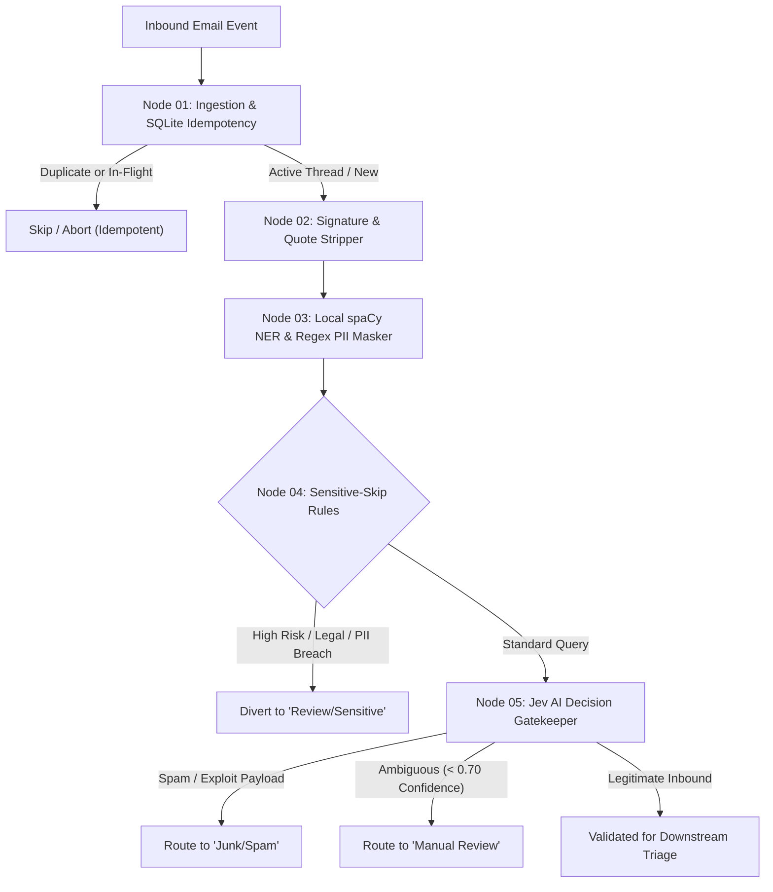

# Customer Email Triage Automation

An enterprise-grade, privacy-first automated email triage pipeline built on **LangGraph**. The system intercepts incoming customer inquiries, deduplicates and tracks processing state via an idempotent SQLite store, strips email signatures and thread history, locally sanitizes PII, applies sensitive guardrail diversions, and evaluates inbound traffic using **Jev AI** decision intelligence.

For current deliverable tracking and project milestones, refer to the [**Project Roadmap**](./ROADMAP.md).

---

## 🏛️ Pipeline Architecture



---

## 🔑 Core System Components

### 1. Ingestion & Idempotency Store (Node 01)
* **Crash-Resilient State Machine:** Utilizes SQLite with three atomic states (`processing`, `done`, `failed`).
* **Stale Lock Recovery:** In-flight tasks exceeding 10 minutes without completion are automatically recovered with incremented retry counters.
* **Active Thread Continuity:** Detects ongoing threads to prioritize customer conversations.

### 2. Privacy & Noise Stripping (Node 02)
* **Quote Truncation:** Strips nested email replies (`On <date> ... wrote:`, `-----Original Message-----`, Outlook header dividers).
* **Signature & Disclaimer Removal:** Cleans RFC 3676 delimiters (`-- `), sign-offs (`Best regards`, `Thanks`), mobile footers (`Sent from my iPhone`), and corporate legal disclaimers.
* **Safety Fallback:** Preserves blockquoted error logs and prevents blank body states.

### 3. Local PII Redaction (Node 03)
* **Zero External Leakage:** Runs 100% locally via spaCy NER (`en_core_web_sm`) and compiled regexes on CPU.
* **Bi-directional Token Mapping:** Converts customer names, emails, phone numbers, and credentials to anonymous tokens (`[PERSON_1]`, `[EMAIL_1]`) prior to any third-party network egress.

### 4. Sensitive Guardrails & Diversion (Node 04)
* **Rule-Based Diversion:** Intercepts sensitive legal, regulatory, or account security queries before LLM ingestion.
* **Human-in-the-Loop Quarantine:** Routes matching emails directly to the human review queue.

### 5. Jev AI Decision Gatekeeper (Node 05)
* **Primary Classifier:** Sub-second threat and spam classification powered by Jev AI.
* **High Availability Fallback:** Automatic failover to Groq (`llama-3.1-8b-instant`) in the event of timeouts or upstream API latency.
* **Tri-State Routing:** Labels items as `legitimate`, `spam`, or `manual_review`.

---

## 📁 Repository Structure

```
Customer-Email-Triage-Automation/
├── config.yaml               # Central system and threshold configuration
├── Dockerfile                # Production container specification
├── docker-compose.yml        # Multi-container orchestration
├── db/
│   └── database.py           # SQLite idempotency engine
├── nodes/
│   ├── ingest.py             # Node 01: Ingestion and idempotency
│   ├── signature_stripper.py # Node 02: Quote and signature removal
│   ├── pii_masker.py         # Node 03: Local spaCy & regex redaction
│   ├── sensitive_skip.py     # Node 04: Sensitive guardrail diversion
│   └── jev_gatekeeper.py     # Node 05: Jev AI decision engine
├── state.py                  # LangGraph TriageState & Pydantic models
├── tests/                    # Unit and integration test suites
└── utils/
    ├── config.py             # Environment and config loader
    └── jev_client.py         # Jev AI client with fallback handler
```

---

## 🚀 Getting Started

### Prerequisites
* Python 3.11+
* Docker & Docker Compose (optional, for containerized execution)

### Local Setup
1. Clone the repository and initialize the environment:
   ```bash
   python3 -m venv venv
   source venv/bin/activate
   pip install -r requirements.txt
   python -m spacy download en_core_web_sm
   ```

2. Configure environment variables:
   ```bash
   cp .env.example .env
   # Populate JEV_API_KEY, GROQ_API_KEY, etc. in .env
   ```

3. Run the automated test suite:
   ```bash
   python3 -m unittest discover tests
   ```

### Docker Execution
```bash
docker compose build
docker compose up -d
```

---

## 🔒 Security & Privacy Principles
* **Zero Hardcoded Secrets:** No API keys or tokens are stored in code or configuration files. All credentials use environment variable substitution (`*_env`).
* **On-Premise Redaction:** PII masking executes locally prior to external AI invocation.
