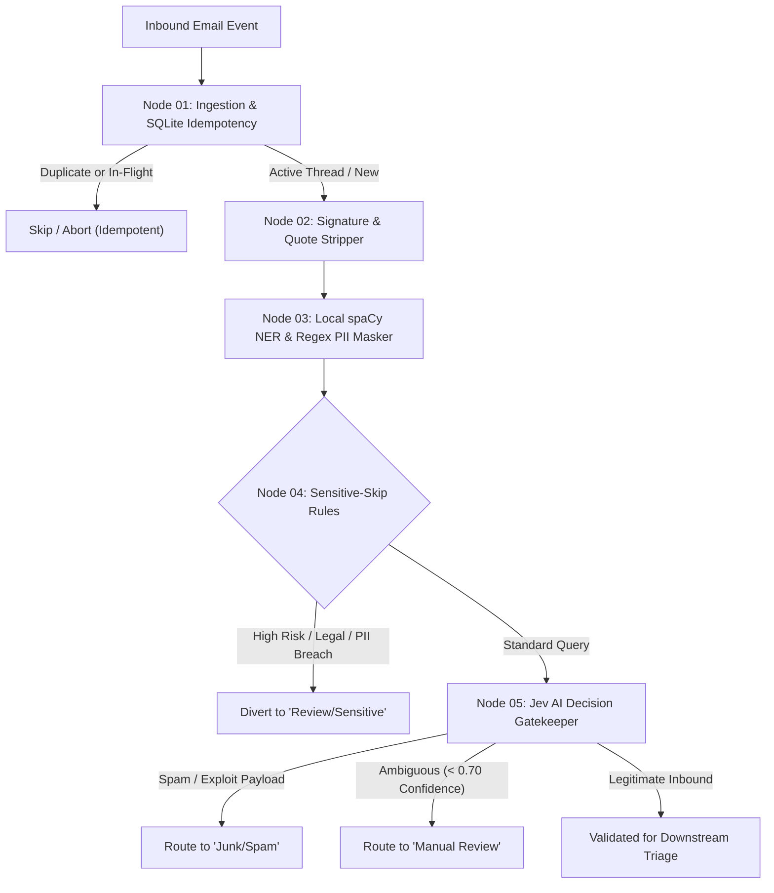

# Customer Email Triage Automation

An enterprise-grade, privacy-first automated email triage pipeline built on **LangGraph**. The system intercepts incoming customer inquiries, deduplicates and tracks processing state via an idempotent SQLite store, strips email signatures and thread history, locally sanitizes PII, applies sensitive guardrail diversions, and evaluates inbound traffic using **Jev AI** decision intelligence.

For current deliverable tracking and project milestones, refer to the [**Project Roadmap**](./ROADMAP.md).

---

## 🏛️ Pipeline Architecture



---

## 🔑 Core System Components

### 1. Ingestion & Idempotency Store (Node 01)
* **Crash-Resilient State Machine:** Utilizes SQLite with three atomic states (`processing`, `done`, `failed`).
* **Stale Lock Recovery:** In-flight tasks exceeding 10 minutes without completion are automatically recovered with incremented retry counters.
* **Active Thread Continuity:** Detects ongoing threads to prioritize customer conversations.

### 2. Privacy & Noise Stripping (Node 02)
* **Quote Truncation:** Strips nested email replies (`On <date> ... wrote:`, `-----Original Message-----`, Outlook header dividers).
* **Signature & Disclaimer Removal:** Cleans RFC 3676 delimiters (`-- `), sign-offs (`Best regards`, `Thanks`), mobile footers (`Sent from my iPhone`), and corporate legal disclaimers.
* **Safety Fallback:** Preserves blockquoted error logs and prevents blank body states.

### 3. Local PII Redaction (Node 03)
* **Zero External Leakage:** Runs 100% locally via spaCy NER (`en_core_web_sm`) and compiled regexes on CPU.
* **Bi-directional Token Mapping:** Converts customer names, emails, phone numbers, and credentials to anonymous tokens (`[PERSON_1]`, `[EMAIL_1]`) prior to any third-party network egress.

### 4. Sensitive Guardrails & Diversion (Node 04)
* **Rule-Based Diversion:** Intercepts sensitive legal, regulatory, or account security queries before LLM ingestion.
* **Human-in-the-Loop Quarantine:** Routes matching emails directly to the human review queue.

### 5. Jev AI Decision Gatekeeper (Node 05)
* **Primary Classifier:** Sub-second threat and spam classification powered by Jev AI.
* **High Availability Fallback:** Automatic failover to Groq (`llama-3.1-8b-instant`) in the event of timeouts or upstream API latency.
* **Tri-State Routing:** Labels items as `legitimate`, `spam`, or `manual_review`.

---

## 📁 Repository Structure

```
Customer-Email-Triage-Automation/
├── config.yaml               # Central system and threshold configuration
├── Dockerfile                # Production container specification
├── docker-compose.yml        # Multi-container orchestration
├── db/
│   └── database.py           # SQLite idempotency engine
├── nodes/
│   ├── ingest.py             # Node 01: Ingestion and idempotency
│   ├── signature_stripper.py # Node 02: Quote and signature removal
│   ├── pii_masker.py         # Node 03: Local spaCy & regex redaction
│   ├── sensitive_skip.py     # Node 04: Sensitive guardrail diversion
│   └── jev_gatekeeper.py     # Node 05: Jev AI decision engine
├── state.py                  # LangGraph TriageState & Pydantic models
├── tests/                    # Unit and integration test suites
└── utils/
    ├── config.py             # Environment and config loader
    └── jev_client.py         # Jev AI client with fallback handler
```

---

## 🐳 Complete Guide: Running in Docker on Any Computer

This project is fully containerized. You can run it on **any computer in the world** (Linux, macOS, or Windows) without needing to configure local Python versions or spaCy C-compilers.

### 1. Prerequisites (Cross-Platform)

Ensure your machine has **Docker** and **Docker Compose** installed:

| Operating System | Recommended Installation | Notes |
|:---|:---|:---|
| **Windows 10/11** | [Docker Desktop for Windows](https://docs.docker.com/desktop/setup/install/windows-install/) | Use the **WSL 2 backend** (enabled by default). |
| **macOS (Intel & Apple Silicon M1/M2/M3)** | [Docker Desktop for Mac](https://docs.docker.com/desktop/setup/install/mac-install/) | Works natively on both ARM64 and x86_64 architectures. |
| **Linux (Ubuntu, Debian, Fedora, Arch)** | [Docker Engine](https://docs.docker.com/engine/install/) + `docker-compose-plugin` | Ensure non-root access: `sudo usermod -aG docker $USER`. |

Verify your installation in your terminal / command prompt:
```bash
docker --version
docker compose version
```

---

### 2. Step-by-Step Setup & Execution

#### Step 1: Clone the Repository
Open a terminal (or PowerShell / Git Bash on Windows) and run:
```bash
git clone https://github.com/<your-org>/Customer-Email-Triage-Automation.git
cd Customer-Email-Triage-Automation
```

#### Step 2: Configure Environment Variables
Copy the template configuration file to `.env`:

* **Linux / macOS / Git Bash:**
  ```bash
  cp .env.example .env
  ```
* **Windows (PowerShell):**
  ```powershell
  Copy-Item .env.example .env
  ```
* **Windows (Command Prompt):**
  ```cmd
  copy .env.example .env
  ```

Open `.env` in any text editor and fill in your API credentials (e.g., `JEV_API_KEY`, `GROQ_API_KEY`).

#### Step 3: Build the Docker Image
Build the container. This automatically sets up Python 3.11, installs all requirements, and downloads the local spaCy NER model (`en_core_web_sm`):
```bash
docker compose build
```

> **Tip:** If dependencies change in the future, rebuild with:
> ```bash
> docker compose build --no-cache
> ```

#### Step 4: Run the Application
Launch the containerized triage service in the background:
```bash
docker compose up -d
```

To run in the foreground with live console logs:
```bash
docker compose up
```

#### Step 5: Run Automated Tests Inside Docker
You can execute the entire test suite inside the exact container runtime environment on any machine without installing Python locally:
```bash
docker compose run --rm email-triage python -m unittest discover tests
```

#### Step 6: Interactive Terminal / Debugging
If you need to enter the running container to inspect the environment, SQLite database, or files:
```bash
docker compose run --rm email-triage bash
```

---

### 3. Data Persistence & Volume Mounts

The container uses Docker bind-mounts defined in `docker-compose.yml`:
* **Live Code Reloading:** `.:/app` maps your local directory inside the container, allowing code changes to take effect immediately without rebuilding.
* **Persistent SQLite Database:** `./data:/app/data` stores the SQLite idempotency database file (`data/triage.db`). 
* Even if the container is stopped, deleted, or rebuilt, **all processing history and idempotency locks remain safely persisted on your host machine**.

---

### 4. Essential Docker Management Commands

| Action | Command |
|:---|:---|
| **View Live Container Logs** | `docker compose logs -f email-triage` |
| **Stop Running Containers** | `docker compose stop` |
| **Stop and Remove Containers** | `docker compose down` |
| **Restart the Service** | `docker compose restart` |
| **View Running Container Status** | `docker compose ps` |

---

### 5. Troubleshooting Common Issues

* **Error: `.env` file not found:**
  * Ensure you created the `.env` file from `.env.example` in the project root directory before running `docker compose up`.
* **Linux Permission Denied on `data/` folder:**
  * If the container fails to write to `triage.db`, ensure your host user has write permissions:
    ```bash
    mkdir -p data && chmod 777 data
    ```
* **Windows Line Endings (CRLF vs LF):**
  * If shell scripts inside Docker fail with `\r` errors, ensure Git didn't convert line endings to CRLF:
    ```bash
    git config core.autocrlf input
    ```
* **Port / Process Conflicts:**
  * If an older container is still running, shut it down cleanly:
    ```bash
    docker compose down --remove-orphans
    ```

---

## 💻 Optional: Local Development Setup (Without Docker)

If you prefer developing directly on your host machine without Docker:

```bash
# 1. Create and activate a virtual environment
python3 -m venv venv
source venv/bin/activate  # On Windows: .\venv\Scripts\activate

# 2. Install dependencies & spaCy NER model
pip install -r requirements.txt
python -m spacy download en_core_web_sm

# 3. Configure environment
cp .env.example .env

# 4. Run tests
python -m unittest discover tests
```

---

## 🔒 Security & Privacy Principles
* **Zero Hardcoded Secrets:** No API keys or tokens are stored in code or configuration files. All credentials use environment variable substitution (`*_env`).
* **On-Premise Redaction:** PII masking executes locally prior to external AI invocation.
