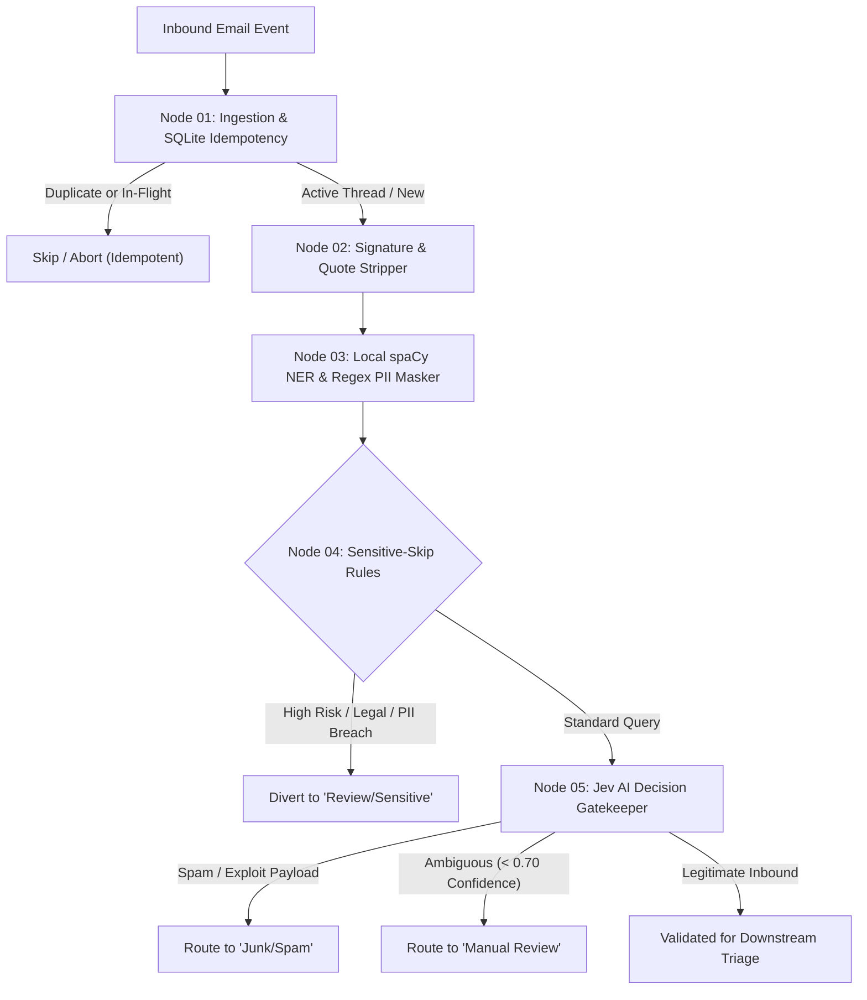

# Customer Email Triage Automation

A local-first, privacy-preserving automated email triage pipeline built on **LangGraph**. The system intercepts incoming customer inquiries, deduplicates and tracks processing state via an idempotent SQLite store, strips email signatures and thread history, locally sanitizes PII, applies sensitive guardrail diversions, and evaluates inbound traffic using **Jev AI** decision intelligence.

For current deliverable tracking and project milestones, refer to the [**Project Roadmap**](./ROADMAP.md).

---

## 🏛️ Pipeline Architecture



---

## 🔑 Core System Components

### 1. Ingestion & Idempotency Store (Node 01)
* **Crash-Resilient State Machine:** Utilizes SQLite with three atomic states (`processing`, `done`, `failed`).
* **Stale Lock Recovery:** In-flight tasks exceeding 10 minutes without completion are automatically recovered with incremented retry counters.
* **Active Thread Verification:** Detects ongoing threads and verifies that the inbound sender is a known participant of prior messages in the thread.
* **Phase 2 Hand-off Contract:** Phase 2 picks up rows with `routing_status='gatekeeper_approved'` (or via `db.get_gatekeeper_approved()`), reads `masked_subject` and `masked_body` directly from the row, and `token_map` is deliberately not stored (Phase 2 must re-fetch originals from the mailbox by `message_id` if a destination needs unmasked text). Marking them as `status = 'done'` guarantees immediate retransmissions within 10 minutes are recognized as duplicates without blocking Phase 2 downstream execution.

### 2. Privacy & Noise Stripping (Node 02)
* **Quote Truncation:** Strips nested email replies (`On <date> ... wrote:`, `-----Original Message-----`, Outlook header dividers).
* **Signature & Disclaimer Removal:** Cleans RFC 3676 delimiters (`-- `), sign-offs (`Best regards`, `Thanks`), mobile footers (`Sent from my iPhone`), and corporate legal disclaimers.
* **Safety Fallback:** Preserves blockquoted error logs and prevents blank body states.

### 3. Local PII Redaction (Node 03)
* **Zero External Leakage:** Runs 100% locally via spaCy NER (`en_core_web_sm`) and compiled regexes on CPU.
* **Bi-directional Token Mapping:** Converts customer names, emails, phone numbers, and credentials to anonymous tokens (`[PERSON_1]`, `[EMAIL_1]`) prior to any third-party network egress.

### 4. Sensitive Guardrails & Diversion (Node 04)
* **Rule-Based Diversion:** Intercepts sensitive legal, regulatory, or account security queries before LLM ingestion.
* **Human-in-the-Loop Quarantine:** Routes matching emails directly to the human review queue.

### 5. Jev AI Decision Gatekeeper (Node 05)
* **Primary Classifier:** Low-latency threat and spam classification powered by TypeSafe System One (Jev `jev-1.13.0`) with local heuristic fallback (average offline pipeline throughput ~27ms/email).
* **High Availability Fallback:** Automatic failover to Groq (`openai/gpt-oss-20b`) and deterministic regex heuristics.
* **Tri-State Routing:** Labels items as `legitimate`, `spam`, or `manual_review`.

#### 🚀 Enabling TypeSafe System One (Jev)
To evaluate incoming inquiries with live AI:
1. **Recommended First Step — One-Call Connectivity Smoke Test:**
   Always verify connectivity and API key validity with a single isolated test call before running full batches:
   ```bash
   python scripts/jev_smoke_test.py
   ```
   *(Or inside Docker: `docker compose run --rm email-triage python scripts/jev_smoke_test.py`)*

2. **Full Benchmark Evaluation (`--live`):**
   ```bash
   python main.py --live
   ```
   *(Or inside Docker: `docker compose run --rm email-triage python main.py --live`)*

   > [!WARNING]
   > Running `python main.py --live` transmits all 100 benchmark emails to the live external APIs (generating roughly 100 to 200 external network calls, incurring real API usage costs, and potentially triggering Groq free-tier 429 rate limits). Furthermore, several benchmark scenario expectations in `data/benchmark_emails.json` are calibrated against offline heuristic baselines and live AI decisions may legitimately vary.

*(Note: Without a real key or with placeholder credentials, the pipeline runs in offline mode using the local heuristic fallback).*

---

## 📁 Repository Structure

```
Customer-Email-Triage-Automation/
├── .dockerignore              # Docker build exclusions
├── .env.example              # Environment variables template
├── .gitignore                # Git repository ignore rules
├── AGENTS.md                 # Operating rules, invariants, and guardrails for AI agents
├── check.sh                  # All-in-one testing, linting, and egress verification script
├── config/
│   └── tech_terms.txt        # Two-tier technical terms whitelist (unambiguous / ambiguous)
├── config.yaml               # Central system and threshold configuration
├── Dockerfile                # Production container specification
├── docker-compose.yml        # Multi-container orchestration
├── docs/
│   ├── ARCHITECTURE.md       # Pipeline architecture, state map, database schema, & config reference
│   ├── contracts/            # External API contract specifications
│   └── phase2_decisions.md   # Architectural decisions for Phase 2
├── GEMINI.md -> AGENTS.md    # Agent instructions symlink
├── main.py                   # Production entry point and CLI benchmark runner
├── pipeline.py               # LangGraph compiled pipeline orchestrator
├── prompts.py                # Classifier LLM system and user prompt templates
├── pyproject.toml            # Development tool configurations (ruff, mypy, bandit, pytest)
├── README.md                 # Project documentation and quickstart guide
├── requirements.txt          # Pinned runtime production dependencies
├── requirements-dev.txt      # Pinned development and testing dependencies
├── ROADMAP.md                # 24-point senior review remediation roadmap
├── state.py                  # LangGraph TriageState & Pydantic models
├── data/
│   ├── benchmark_emails.json # 100-scenario synthetic benchmark dataset
│   ├── sample_email.json     # Sample legitimate email payload
│   └── sample_email_spam.json# Sample spam email payload
├── db/
│   └── database.py           # SQLite idempotency engine
├── nodes/
│   ├── ingest.py             # Node 01: Ingestion and idempotency
│   ├── signature_stripper.py # Node 02: Quote and signature removal
│   ├── pii_masker.py         # Node 03: Local spaCy & regex redaction
│   ├── sensitive_skip.py     # Node 04: Sensitive guardrail diversion
│   ├── jev_gatekeeper.py     # Node 05: Jev AI decision engine
│   ├── classifier.py         # Node 06: Phase 2 category & priority classifier
│   └── hitl_queue.py         # Node 07: Phase 2 human-in-the-loop review queue
├── scripts/
│   ├── hitl_cli.py           # Reviewer CLI interface for HITL queue management
│   ├── jev_smoke_test.py     # Standalone TypeSafe System One connectivity smoke test
│   └── manual_classifier_check.py # Offline classifier verification script
├── tests/                    # Comprehensive unit and integration test suite (444 tests)
│   ├── conftest.py           # Test isolation fixtures & network egress guards
│   ├── test_a12_container_security.py
│   ├── test_a14_dependency_pinning.py
│   ├── test_architecture_doc.py
│   ├── test_benchmark_runner.py
│   ├── test_c2_isolation.py
│   ├── test_c3_smoke_test.py
│   ├── test_fix_b4_state_db_sync.py
│   ├── test_fix_b5_config.py
│   ├── test_fix_b6_lifecycle.py
│   ├── test_ingest_idempotency.py
│   ├── test_jev_client.py
│   ├── test_jev_gatekeeper.py
│   ├── test_main.py
│   ├── test_no_stale_claims.py
│   ├── test_p2_classifier.py
│   ├── test_p2_egress.py
│   ├── test_p2_hitl.py
│   ├── test_pii_masker.py
│   ├── test_pipeline_e2e.py  # End-to-end integration and benchmark tests
│   ├── test_readme_metrics.py
│   ├── test_sensitive_skip.py
│   └── test_signature_stripper.py
├── tools/
│   ├── check_concurrency.py  # Multiprocess / multithread concurrency verification
│   └── egress_check.py       # Zero-network-leak verification tool
└── utils/
    ├── classifier_client.py  # Multi-tier classifier client (Jev AI & Groq fallback)
    ├── config.py             # Environment and config loader
    ├── jev_client.py         # Jev AI client with fallback handler
    └── text_tools.py         # Bounded text scanning & normalization helpers
```

---

## 🐳 Complete Guide: Running in Docker on Any Computer

This project is fully containerized. You can run it on **any computer in the world** (Linux, macOS, or Windows) without needing to configure local Python versions or spaCy C-compilers.

### 1. Prerequisites (Cross-Platform)

Ensure your machine has **Docker** and **Docker Compose** installed:

| Operating System | Recommended Installation | Notes |
|:---|:---|:---|
| **Windows 10/11** | [Docker Desktop for Windows](https://docs.docker.com/desktop/setup/install/windows-install/) | Use the **WSL 2 backend** (enabled by default). |
| **macOS (Intel & Apple Silicon M1/M2/M3)** | [Docker Desktop for Mac](https://docs.docker.com/desktop/setup/install/mac-install/) | Works natively on both ARM64 and x86_64 architectures. |
| **Linux (Ubuntu, Debian, Fedora, Arch)** | [Docker Engine](https://docs.docker.com/engine/install/) + `docker-compose-plugin` | Ensure non-root access: `sudo usermod -aG docker $USER`. |

Verify your installation in your terminal / command prompt:
```bash
docker --version
docker compose version
```

---

### 2. Step-by-Step Setup & Execution

#### Step 1: Clone the Repository
Open a terminal (or PowerShell / Git Bash on Windows) and run:
```bash
git clone https://github.com/<your-org>/Customer-Email-Triage-Automation.git
cd Customer-Email-Triage-Automation
```

#### Step 2: Configure Environment Variables
Copy the template configuration file to `.env`:

* **Linux / macOS / Git Bash:**
  ```bash
  cp .env.example .env
  ```
* **Windows (PowerShell):**
  ```powershell
  Copy-Item .env.example .env
  ```
* **Windows (Command Prompt):**
  ```cmd
  copy .env.example .env
  ```

Open `.env` in any text editor and fill in your API credentials (e.g., `JEV_API_KEY`, `GROQ_API_KEY`).

##### Environment Variable Overrides & Precedence
The application enforces a fail-fast configuration model. Runtime system parameters can be overridden via environment variables with strict precedence (`env > config.yaml`):

| Variable | Target Config Key | Type | Description |
|---|---|---|---|
| `DATABASE_PATH` | `system.database_path` | String | Path to persistent SQLite idempotency database |
| `IDEMPOTENCY_STALE_MINUTES` | `system.idempotency_stale_minutes` | Integer (`> 0`) | Stale lock recovery window before in-progress emails are recovered |
| `MAX_DISPATCH_RETRIES` | `system.max_dispatch_retries` | Integer (`>= 0`) | Maximum retry attempts permitted for stale or failed emails |

If an override variable is unset or empty, the value defined in `config.yaml` is used. If an invalid value is supplied, the application fails fast at startup with exit code `2` naming the invalid variable without leaking environment secrets.

#### Step 3: Build the Docker Image
Build the container. By default, this installs all production and development dependencies (including `pytest`) and downloads the local spaCy NER model (`en_core_web_sm`):
```bash
docker compose build
```

> **Slim Image Build:** To create a slim image without testing dependencies, specify `WITH_TESTS=false`:
> ```bash
> docker compose build --build-arg WITH_TESTS=false
> ```
> *(Tip: If dependencies change in the future, rebuild with `docker compose build --no-cache`).*

#### Step 4: Run the Application
Phase 1 operates as a batch execution pipeline rather than an always-on background listener.

To execute the 100-scenario benchmark suite once and exit:
```bash
docker compose up
```

To process a single email payload once and exit:
```bash
docker compose run --rm email-triage python main.py --input data/sample_email.json --offline
```

#### Step 5: Run Automated Tests Inside Docker
You can execute the entire test suite inside the exact container runtime environment on any machine without installing Python locally:
```bash
docker compose run --rm email-triage pytest tests/ -v
```

#### Step 6: Interactive Terminal / Debugging
If you need to enter the container environment to inspect SQLite data or files:
```bash
docker compose run --rm email-triage bash
```

---

### 3. Data Persistence & Volume Mounts

The container uses a dedicated data volume mount defined in `docker-compose.yml`:
* **Persistent SQLite Database:** `./data:/app/data` stores the SQLite idempotency database file (`data/triage.db`). The host repository source code is not mounted into `/app`, ensuring container immutability and preventing host filesystem modification.
* Even if the container is deleted or rebuilt, **all processing history and idempotency locks remain safely persisted on your host machine**.

---

### 4. Essential Docker Commands

| Action | Command |
|:---|:---|
| **Run Offline Benchmark (100 Scenarios)** | `docker compose up` |
| **Process Single Email Payload** | `docker compose run --rm email-triage python main.py --input data/sample_email.json --offline` |
| **Run Container Test Suite** | `docker compose run --rm email-triage pytest tests/ -v` |
| **Run Connectivity Smoke Test** | `docker compose run --rm email-triage python scripts/jev_smoke_test.py` |
| **Clean Up Containers & Networks** | `docker compose down` |
| **View Container Status** | `docker compose ps` |

---

### 5. Troubleshooting Common Issues

* **Error: `.env` file not found:**
  * Ensure you created the `.env` file from `.env.example` in the project root directory before running `docker compose up`.
* **Linux Permission Denied on `data/` folder:**
  * If the container fails to write to `triage.db`, ensure the container's non-root `appuser` (UID 1000) owns the data directory:
    ```bash
    mkdir -p data && chown -R 1000:1000 data
    ```
* **Windows Line Endings (CRLF vs LF):**
  * If shell scripts inside Docker fail with `\r` errors, ensure Git didn't convert line endings to CRLF:
    ```bash
    git config core.autocrlf input
    ```
* **Port / Process Conflicts:**
  * If an older container is still running, shut it down cleanly:
    ```bash
    docker compose down --remove-orphans
    ```

---

## 💻 Optional: Local Development Setup (Without Docker)

If you prefer developing directly on your host machine without Docker:

```bash
# 1. Create and activate a virtual environment
python3 -m venv venv
source venv/bin/activate  # On Windows: .\venv\Scripts\activate

# 2. Install dependencies & spaCy NER model
pip install -r requirements-dev.txt
python -m spacy download en_core_web_sm

# 3. Configure environment
cp .env.example .env

# 4. Run automated test suite (444 tests, 100% passing)
pytest tests/ -v

# 5. Run the synthetic benchmark suite across all 100 pipeline scenarios (default: offline)
python main.py
# (Or use python main.py --live to evaluate with live TypeSafe System One / Jev API)

# 6. Process an individual email JSON payload
python main.py --input path/to/email.json

# 7. Human-in-the-Loop Reviewer CLI interface
python scripts/hitl_cli.py list                    # List pending review items
python scripts/hitl_cli.py list --json             # JSON output for tooling
python scripts/hitl_cli.py show <email_id>         # Inspect item with masked text
python scripts/hitl_cli.py approve <email_id> --by alice [--notes "..."] [--category C] [--team T]
python scripts/hitl_cli.py reject <email_id> --by bob --notes "Rejection reason"

# 8. Run egress check & all-in-one verification
./check.sh all
```

---

## 🔒 Security & Privacy Principles
* **Zero Hardcoded Secrets:** No API keys or tokens are stored in code or configuration files. All credentials use environment variable substitution (`*_env`).
* **On-Premise Redaction:** PII masking executes locally prior to external AI invocation.
