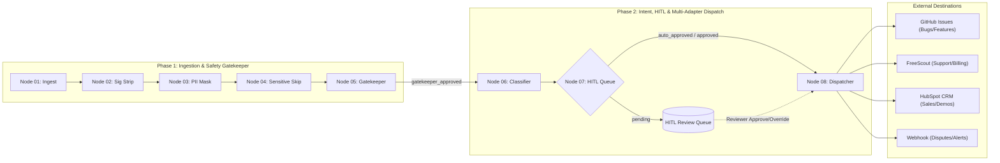
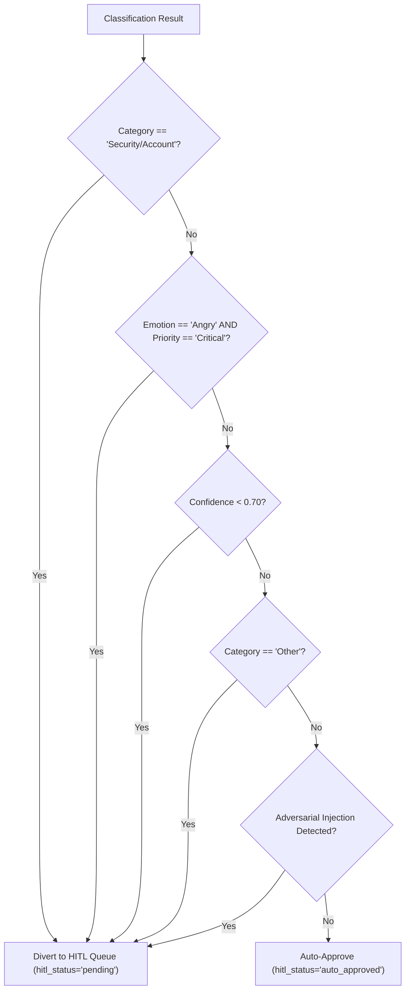
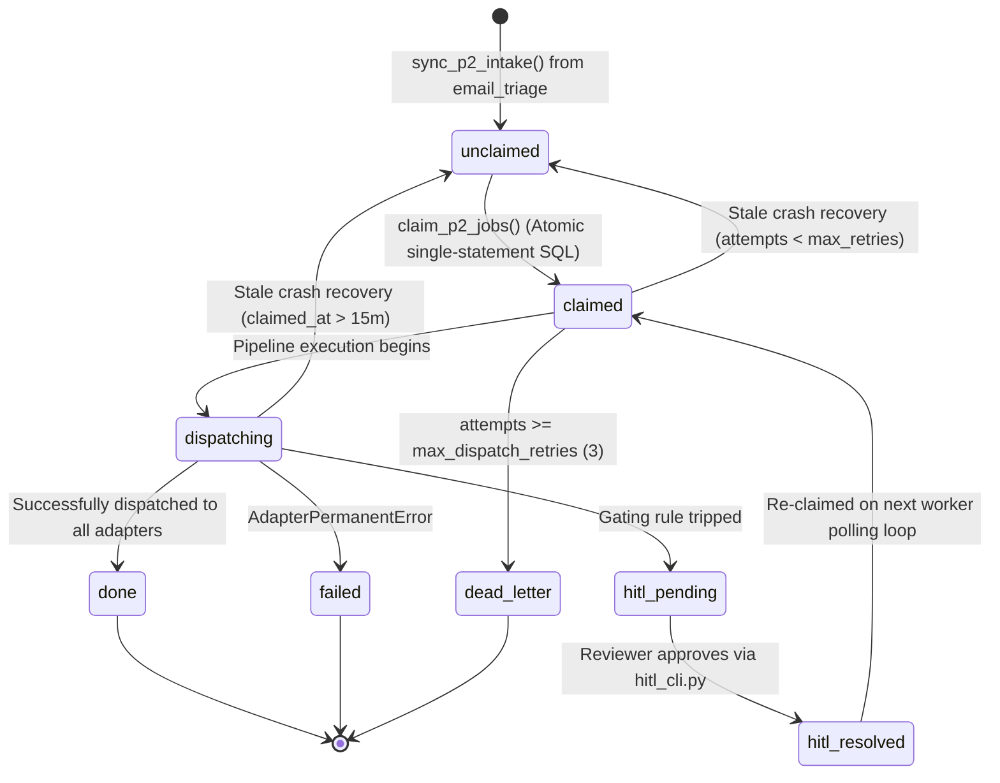

# Phase 2 Architecture & Technical Reference

This document provides a comprehensive technical reference for **Phase 2** of the Customer Email Triage Automation pipeline.

For general project architecture and Phase 1 invariants, see [docs/ARCHITECTURE.md](file:///mnt/D48444128443F610/Customer-Email-Triage-Automation/docs/ARCHITECTURE.md).

---

## 1. Executive Summary & Phase Boundaries

Phase 1 provides local ingestion, sanitization, precision PII masking, sensitive topic diversion, and gatekeeper threat filtering. Phase 2 extends the platform into an enterprise-grade automated dispatch pipeline:

1. **Deep Semantic Classification (Node 06):** Classifies approved customer emails into a 10-category taxonomy, calculates urgency priority, and evaluates customer emotional state.
2. **Human-in-the-Loop (HITL) Queue (Node 07):** Evaluates deterministic policy triggers (security topics, escalated customer anger, low confidence, ambiguous queries) and diverts sensitive emails for human review.
3. **Multi-Destination Dispatcher (Node 08):** Routes approved emails to authorized external systems (GitHub Issues, FreeScout Support Desk, CRM Lead Ingestion, Webhook Alerts) with outbox ledger idempotency, rate limiting, and circuit breakers.
4. **Persistent Autonomous Queue Worker:** Asynchronous background worker (`scripts/phase2_worker.py`) consuming gatekeeper-approved records using single-statement atomic batch claiming, crash recovery, and dead-letter queueing.



### Strict Immutability Invariant (Hard Invariant #10)
Phase 2 **never** modifies or overwrites Phase 1 database columns:
- `email_triage.status` is restricted to `('processing', 'done', 'failed')`.
- `email_triage.routing_status` remains `gatekeeper_approved` as written by Phase 1.
- `email_triage.masked_subject` and `email_triage.masked_body` remain pristine.
- All Phase 2 lifecycle states are isolated in dedicated tables: `p2_jobs` and `p2_dispatch_log`.

---

## 2. LangGraph Pipeline Topologies

The system supports two distinct LangGraph pipeline execution models via `pipeline.py`:

### Model A: Unified Ingestion-to-Dispatch Pipeline (`create_triage_pipeline(phase2=True)`)
Processes an email end-to-end in a single execution invocation, connecting Node 01 through Node 08. Used for synchronous benchmark evaluations, CLI ad-hoc testing, and integration tests.

### Model B: Autonomous Worker Sub-Graph (`create_phase2_worker_pipeline()`)
Operates as a decoupled background service. The pipeline starts directly at Node 06 (`classifier`), consuming approved emails claimed from SQLite without re-running Phase 1 redaction or gatekeeper heuristics.

```mermaid
flowchart TD
    subgraph UnifiedExecution["Unified Pipeline Topology (phase2=True)"]
        A["Inbound Email"] --> N1["01: Ingest & Idempotency"]
        N1 --> N2["02: Signature Stripper"]
        N2 --> N3["03: PII Masker"]
        N3 --> N4{"04: Sensitive Skip"}
        N4 -->|Normal| N5{"05: Gatekeeper"}
        N4 -->|Sensitive| END1["Sensitive Diverted"]
        N5 -->|Approved| N6["06: Semantic Classifier"]
        N5 -->|Spam / Threat| END2["Spam Skipped / Manual Review"]
        N6 --> N7{"07: HITL Review Gate"}
        N7 -->|Auto-Approved| N8["08: Multi-Destination Dispatcher"]
        N7 -->|Pending Review| HITL_STOP["Halt: Awaiting Reviewer Action"]
        N8 --> DISPATCH_END["Outbox Ledger Confirmed"]
    end

    subgraph WorkerExecution["Standalone Worker Topology (create_phase2_worker_pipeline)"]
        W_START["Claimed Job from SQLite (p2_jobs)"] --> W_N6["06: Semantic Classifier"]
        W_N6 --> W_N7{"07: HITL Review Gate"}
        W_N7 -->|Auto-Approved| W_N8["08: Multi-Destination Dispatcher"]
        W_N7 -->|Pending Review| W_HITL["Transition p2_jobs: hitl_pending"]
        W_N8 --> W_DONE["Transition p2_jobs: done"]
    end
```



---

## 3. Deep Classification Taxonomy & Emotion Model

Node 06 evaluates the email's masked content (`masked_subject`, `masked_body`) and populates `state["classification"]` with an `EmailClassification` model:

### 10-Category Taxonomy
1. **`Bug Report`**: System crashes, errors, memory leaks, broken UI functionality.
2. **`Feature Request`**: Proposals for new capabilities, integrations, or UX enhancements.
3. **`Demo Request`**: Inquiries requesting product walkthroughs, enterprise evaluations.
4. **`Pricing Inquiry`**: Requests for tier pricing, enterprise quotes, seat discounts.
5. **`Billing Issue`**: Failed charges, invoice inquiries, payment method updates.
6. **`Refund Request`**: Requests for money back, dispute over billing deductions.
7. **`Security/Account`**: Password resets, 2FA failures, suspected compromise, account lockout.
8. **`Complaint`**: General customer dissatisfaction, service level complaints.
9. **`General Query`**: Informational questions regarding product specs or company policies.
10. **`Other`**: Ambiguous, multi-intent, or uncategorized customer communications.

### Emotional State & Urgency Dimensions
- **Customer Emotion:** `Calm`, `Frustrated`, `Angry` (evaluated independently of sentiment).
- **Sentiment:** `Positive`, `Neutral`, `Negative`.
- **Priority:** `Critical`, `High`, `Medium`, `Low`.
- **Suggested Teams:** `Engineering`, `Sales`, `Billing`, `Support`, `Security`.

---

## 4. Human-in-the-Loop (HITL) Queue & Decision Gating

Node 07 intercepts classified emails before any external API calls can be executed. Emails are diverted to the `hitl_pending` queue when any of the following deterministic criteria are met:



### HITL Review States (`hitl_status`)
- **`none`**: Default initialized state.
- **`pending`**: Diverted to human review queue; automated dispatch is halted.
- **`auto_approved`**: Cleared all safety checks automatically; approved for immediate dispatch.
- **`approved`**: Reviewed and approved by a human operator without modifying routing.
- **`rejected`**: Discarded or rejected by a human operator.

---

## 5. Persistent Queue Worker & State Lifecycle

The background queue worker (`scripts/phase2_worker.py`) provides resilient, concurrent batch processing of approved emails.



### Atomic Claiming Query
Race conditions across multiple worker processes are completely eliminated by executing a single atomic SQL transaction:
```sql
UPDATE p2_jobs
SET state = 'claimed',
    worker_id = ?,
    claimed_at = CURRENT_TIMESTAMP,
    attempts = attempts + 1,
    updated_at = CURRENT_TIMESTAMP
WHERE email_id IN (
    SELECT email_id FROM p2_jobs
    WHERE state IN ('unclaimed', 'hitl_resolved')
    ORDER BY created_at ASC
    LIMIT ?
);
```

---

## 6. Outbox Ledger Pattern & Distributed Deduplication

External calls are inherently prone to network dropouts and timeout ambiguities. Phase 2 implements a distributed Outbox Ledger pattern backed by `p2_dispatch_log` to guarantee zero duplicate submissions.

```mermaid
sequenceDiagram
    autonumber
    participant W as Queue Worker
    participant L as Outbox Ledger (p2_dispatch_log)
    participant A as Destination Adapter
    participant R as Remote API (GitHub/FreeScout/CRM/Webhook)

    W->>L: 1. Pre-log dispatch intent (state='dispatching', unique idempotency_key)
    W->>A: 2. Invoke dispatch(payload)
    A->>R: 3. Search for anchored correlation marker <!-- triage-bot:v1 key:... -->
    alt Marker Found on Remote
        R-->>A: Existing entity found (e.g. Issue #42)
        A-->>W: Return existing reference (deduplicated)
        W->>L: Update ledger: state='confirmed', outcome='deduplicated'
    else Marker Not Found
        A->>R: 4. POST /remote/entity (with Idempotency-Key header)
        alt Success 200/201
            R-->>A: Entity Created
            A-->>W: Dispatch Success
            W->>L: Update ledger: state='confirmed', outcome='success'
        alt Post-Send Timeout / Connection Drop
            R--x A: ReadTimeout / Dropped Connection
            A-->>W: AdapterUnknownOutcomeError
            W->>L: Update ledger: state='unknown' (HALT blind retry!)
        alt Permanent 4xx Error
            R-->>A: HTTP 422 Unprocessable
            A-->>W: AdapterPermanentError
            W->>L: Update ledger: state='failed'
        end
    end
```

### Destination Routing Table
| Inbound Category | Primary Destination | Action | Allowed Selective Unmasking |
|:---|:---|:---|:---|
| `Bug Report` | `github` | `create_issue` | None (`use_masked_text_only: true`) |
| `Feature Request` | `github` | `create_issue` | None (`use_masked_text_only: true`) |
| `Demo Request` | `crm` | `create_lead` | Selective Contact Unmasking (`unmask_pii: true`) |
| `Pricing Inquiry` | `crm` | `create_lead` | Selective Contact Unmasking (`unmask_pii: true`) |
| `Billing Issue` | `freescout` | `create_ticket` | Selective Contact Unmasking (`unmask_pii: true`) |
| `Refund Request` | `freescout` | `create_ticket` | Selective Contact Unmasking (`unmask_pii: true`) |
| `Complaint` | `freescout` | `create_ticket` | Selective Contact Unmasking (`unmask_pii: true`) |
| `General Query` | `freescout` | `create_ticket` | Selective Contact Unmasking (`unmask_pii: true`) |
| *Critical Outage / Dispute* | `webhook` | `post_alert` | Secondary alert payload with HMAC signature |

---

## 7. Universal Selective Unmasking & Secret Defense

Downstream systems have distinct privacy requirements. Public or developer-facing issue trackers (GitHub) must never see raw personal data. Conversely, customer support desks (FreeScout) and CRM platforms (HubSpot) require contact details to reply to leads.

### The Selective Unmasking Protocol
When `unmask_pii: true` is configured for authorized destinations:
1. **Allowed Contact Entities:** Placeholders for `PERSON`, `EMAIL`, `PHONE`, and `IP_ADDRESS` are restored using Phase 1 token metadata or mailbox re-fetch.
2. **Permanent Secret Retention:** High-risk financial, identity, and authorization tokens (`CREDIT_CARD`, `SSN`, `IBAN`, `API_KEY`) remain **permanently masked** under all circumstances.
3. **`token_map` Isolation:** The raw dictionary `token_map` is **never** persisted to SQLite, **never** passed to adapters, and **never** logged.
4. **Formula Injection Defenses:** Text dispatched to CSV- or spreadsheet-capable destinations (CRM leads) is scrubbed to prefix dangerous leading characters (`=`, `+`, `-`, `@`, `\t`, `\r`) with single quotes (`'`).
