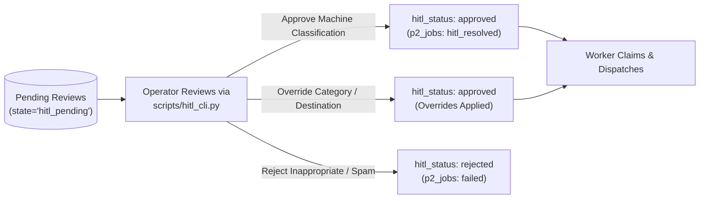

# Human-in-the-Loop (HITL) Queue Operator Runbook

This runbook guides triage operators, customer support leads, and system administrators managing the **Human-in-the-Loop (HITL)** review queue and exception reconciliation.

---

## 1. Overview & Operating Model

Automated classification and dispatch are governed by a **fail-closed** safety philosophy. Any customer email exhibiting high security risk, extreme distress, low model confidence, or ambiguous intent is automatically intercepted by **Node 07 (HITL Queue)** and held in `state = 'hitl_pending'`.

Human reviewers inspect these emails using the interactive command-line interface [`scripts/hitl_cli.py`](file:///mnt/D48444128443F610/Customer-Email-Triage-Automation/scripts/hitl_cli.py). Once reviewed, the email transitions to `hitl_resolved`, allowing the background worker daemon to finish dispatching.



---

## 2. Review Triggers & Gating Rules

Emails enter the review queue when one or more of the following deterministic rules trip:

| Trigger Code | Cause | Automated Action | Operator Action Required |
|:---|:---|:---|:---|
| **TRG-SEC** | `category == "Security/Account"` | Mandatory review | Verify account authenticity. Never dispatch unauthorized credential or 2FA resets. |
| **TRG-EMO** | `customer_emotion == "Angry"` AND `priority == "Critical"` | Escalation review | Verify whether emergency escalation or executive notification is warranted. |
| **TRG-CONF** | `confidence < 0.70` | Low model confidence | Verify that the classified category accurately reflects customer intent. |
| **TRG-OTHER** | `category == "Other"` | Unmapped inquiry | Assign appropriate target category (`Bug Report`, `Billing Issue`, etc.) via `override`. |
| **TRG-INJ** | Adversarial injection pattern detected | Security containment | Inspect customer text for prompt injection attempts. Reject if malicious. |

---

## 3. CLI Command Reference (`scripts/hitl_cli.py`)

All review actions are executed using [`scripts/hitl_cli.py`](file:///mnt/D48444128443F610/Customer-Email-Triage-Automation/scripts/hitl_cli.py).

### 3.1 List Items Awaiting Review
View pending items ordered by arrival time:
```bash
./venv/bin/python scripts/hitl_cli.py list --status pending
```
*Optional flags:*
- `--status`: Filter by status (`pending`, `approved`, `rejected`, `all`). Default: `pending`.
- `--limit`: Number of records to display (default: 20).

### 3.2 Show Email Details
Inspect the masked body, classification metadata, and exact gating reason for a specific email:
```bash
./venv/bin/python scripts/hitl_cli.py show <email_id>
```
*Example Output:*
```text
========================================================================
 Email Review: em_p2_041
========================================================================
 Sender Email   : customer@enterprise.com (Domain: enterprise.com)
 Category       : Security/Account (Confidence: 0.95)
 Priority       : High
 Emotion        : Calm (Sentiment: Neutral)
 Gating Reason  : Category 'Security/Account' requires mandatory human review
 Current Status : hitl_status='pending', p2_status='hitl_pending'

--- Masked Subject ---
Urgent: Suspected unauthorized password reset on our primary admin account

--- Masked Body ---
Hello Security Team, our admin user [PERSON_1_9b2a] received an unsolicited password reset...
```

### 3.3 Approve an Item
Approve the automated classification without alterations. This marks the job `hitl_resolved`, signaling the worker to execute downstream dispatch:
```bash
./venv/bin/python scripts/hitl_cli.py approve <email_id>
```

### 3.4 Override an Item
Correct the classification category, priority, or destination if the model was ambiguous or inaccurate:
```bash
./venv/bin/python scripts/hitl_cli.py override <email_id> \
    --category "Bug Report" \
    --priority "High" \
    --destination "github"
```
*Valid categories:* `Bug Report`, `Feature Request`, `Demo Request`, `Pricing Inquiry`, `Billing Issue`, `Refund Request`, `Security/Account`, `Complaint`, `General Query`, `Other`.  
*Valid priorities:* `Critical`, `High`, `Medium`, `Low`.  
*Valid destinations:* `github`, `freescout`, `crm`, `webhook`.

### 3.5 Reject an Item
Discard malicious payloads, severe abuse, or out-of-scope communications:
```bash
./venv/bin/python scripts/hitl_cli.py reject <email_id> --reason "Confirmed malicious prompt injection"
```

---

## 4. Dead-Letter Queue (DLQ) Remediation

When a job repeatedly fails dispatch (attempts exceed `max_dispatch_retries = 3`), the worker transitions the record to `state = 'dead_letter'` in `p2_jobs`.

### Diagnosing DLQ Jobs
1. Query SQLite for dead-letter records:
   ```bash
   sqlite3 data/triage.db "SELECT email_id, attempts, error_message, updated_at FROM p2_jobs WHERE state = 'dead_letter';"
   ```
2. Inspect the outbox ledger to locate the failing destination:
   ```bash
   sqlite3 data/triage.db "SELECT email_id, destination, state, http_status, error_class FROM p2_dispatch_log WHERE email_id = '<email_id>';"
   ```
3. Common Causes:
   - **Invalid API credentials (`HTTP 401/403`):** Verify destination token in `.env`.
   - **Payload validation failure (`HTTP 422`):** Check unmasking or formatting rules.
   - **Destination unreachable:** Check firewall or remote service status.

### Re-Queueing Dead-Letter Jobs
Once the root cause is resolved, return the job to `unclaimed` state for retry:
```bash
sqlite3 data/triage.db "UPDATE p2_jobs SET state = 'unclaimed', attempts = 0 WHERE email_id = '<email_id>';"
```

---

## 5. Outbox Ledger Reconciliation (`state = 'unknown'`)

If the queue worker drops connection or times out immediately after transmitting an HTTP payload, the adapter marks the ledger entry as:
`state = 'unknown'`, `error_class = 'AdapterUnknownOutcomeError'`

> [!CAUTION]
> **NEVER BLIND-RETRY AN UNKNOWN RECORD.** Blind retries cause duplicate GitHub issues, multiple CRM leads, or duplicate refund tickets.

### Reconciliation Protocol
1. Locate unconfirmed ledger entries:
   ```bash
   sqlite3 data/triage.db "SELECT email_id, destination, idempotency_key FROM p2_dispatch_log WHERE state = 'unknown';"
   ```
2. Search the remote system using the unique `idempotency_key` or email correlation marker (`<!-- triage-bot:v1 key: ... -->`):
   - **GitHub:** Search issues in `owner/repo` for the idempotency marker.
   - **FreeScout:** Search conversations for customer email and subject.
   - **CRM:** Search contacts/leads by sender email.
3. Update Ledger using `hitl_cli reconcile` (Recommended):
   - **If the remote entity was created:**
     ```bash
     ./venv/bin/python scripts/hitl_cli.py reconcile <email_id> \
       --destination <github|freescout|crm|webhook> \
       --status confirmed \
       --by "operator_name" \
       --remote-id "<remote_entity_id_or_url>"
     ```
     This automatically updates the outbox ledger state to `confirmed`, sets `remote_id`, and unblocks any pending HITL review so the background worker completes the job.

   - **If the remote entity was NOT created:**
     ```bash
     ./venv/bin/python scripts/hitl_cli.py reconcile <email_id> \
       --destination <github|freescout|crm|webhook> \
       --status failed \
       --by "operator_name"
     ```
     This marks the dispatch ledger entry as `failed` (`reason='operator_not_sent'`) and unblocks the HITL review.

4. Manual Database Fallback (if CLI is unavailable):
   - **If the remote entity was created:**
     ```bash
     sqlite3 data/triage.db "UPDATE p2_dispatch_log SET state = 'confirmed', remote_id = '<remote_id>', resolved_by = '<operator>' WHERE email_id = '<email_id>' AND state = 'unknown';"
     sqlite3 data/triage.db "UPDATE p2_jobs SET state = 'done' WHERE email_id = '<email_id>';"
     ```
   - **If the remote entity was NOT created:**
     ```bash
     sqlite3 data/triage.db "UPDATE p2_dispatch_log SET state = 'failed', error_message = 'operator_not_sent', resolved_by = '<operator>' WHERE email_id = '<email_id>' AND state = 'unknown';"
     sqlite3 data/triage.db "UPDATE p2_jobs SET state = 'unclaimed' WHERE email_id = '<email_id>';"
     ```
