# 📑 End-to-End Pipeline Trace Report: FreeScout Helpdesk Support Ticket (Channel Notification Configuration)

**Case ID:** `03_freescout_ticket`  
**Email ID:** `case_03_freescout_ticket`  
**Sender:** `elena.rostova@retailhub.de`  
**Subject:** `How to configure Slack webhook notifications for low-priority alerts?`  

---

## 🧭 Executive Summary
* **Routing Decision:** `gatekeeper_approved`
* **Gatekeeper Decision:** `legitimate` (Confidence: `0.95`, Engine: `groq`)
* **Semantic Category:** `General Query` (Priority: `Medium`, Suggested Team: `Support`)
* **HITL Review Status:** `auto_approved` (Reason: `Auto-approved`)
* **Phase 2 Status:** `simulated`
* **Downstream Dispatches:** `1 action(s) scheduled`

```mermaid
flowchart LR
    A["Raw Inbound Email"] --> B["Node 01: Ingestion & Idempotency"]
    B --> C["Node 02: Signature Stripper"]
    C --> D["Node 03: spaCy NER PII Masker"]
    D --> E["Node 04: Sensitive Keyword Check"]
    E --> F["Node 05: Gatekeeper (Groq/Regex)"]
    F --> G["Node 06: Classifier (Groq LLM)"]
    G --> H["Node 07: HITL Review Queue"]
    H --> I["Node 08: Multi-Adapter Dispatcher"]
    I --> J["Outbox Ledger / Live Destination"]
```



---

## 🔍 Stage-by-Stage Verification Breakdown

### 1. Ingestion & Thread Context (Node 01)
* **Message ID / Email ID:** `case_03_freescout_ticket`
* **Sender Domain Isolated:** `retailhub.de`
* **Active Thread Flag:** `False`
* **Database Ledger:** Atomic registration performed with idempotent check-and-claim.

### 2. Signature & Quoted Reply Stripper (Node 02)
* **RFC 3676 / Mobile Cut:** Removed disclaimers, sign-offs, and quote headers.
* **Preserved Core Content:** Kept technical context, stack traces, and customer queries intact without truncation.

### 3. On-Premise PII Redaction & Token Mapping (Node 03)
* **Redacted Entity Breakdown:**
```json
{
  "PERSON": 1,
  "PHONE": 1
}
```
* **Masked Preview:**
> Hello Support Team,

I am currently setting up our team's notification preferences in our account settings.
We would like to know if it's possible to route low-priority alerts to our '#support-general' Slack channel instead of sending immediate SMS n...
* **Zero Leakage Invariant:** Customer names, phone numbers, and raw identifiers were redacted locally on CPU. Zero raw PII was sent to external LLMs.

### 4. Sensitive-Skip Guardrails (Node 04)
* **Is Sensitive:** `False`
* **Sensitive Reason:** `None (Clean)`

### 5. Gatekeeper Spam & Threat Inspection (Node 05)
* **Decision:** `legitimate`
* **Confidence:** `0.95`
* **Engine Used:** `groq`
* **Threat Flag:** `False` (Details: `None`)
* **Spam Flag:** `False`

### 6. Deep Semantic Classification (Node 06)
* **Category:** `General Query`
* **Priority:** `Medium`
* **Sentiment:** `Neutral`
* **Customer Emotion:** `Calm`
* **Suggested Team:** `Support`
* **Confidence Score:** `0.96`
* **Executive Summary:** *Customer asks for documentation or steps to route low‑priority alerts to a Slack channel via webhook instead of SMS.*

### 7. Human-in-the-Loop Gating (Node 07)
* **HITL Status:** `auto_approved`
* **Gating Reason:** `Confidence passed threshold; safe category and calm emotion.`
* **Reviewer Action Required:** None — Automatically passed

### 8. Multi-Destination Dispatcher & Outbox Ledger (Node 08)
* **Outbox Ledger Execution:**
```json
[
  {
    "destination": "freescout",
    "action_type": "create_ticket",
    "mode": "dry_run",
    "ledger_state": "simulated",
    "reason": null,
    "attempts": 0,
    "remote_id": null
  }
]
```
* **Universal Selective Unmasking:** Active (Restores customer contact email for authorized helpdesk/CRM)

---

## 🚀 How to Reproduce This Case Manually

Run the pipeline directly from the repository root:

```bash
# 1. Offline Deterministic Verification
./venv/bin/python main.py --input tests/e2e_pipeline_cases/03_freescout_ticket/email.json --phase2 --offline

# 2. Live Groq Verification (requires GROQ_API_KEY in .env)
./venv/bin/python main.py --input tests/e2e_pipeline_cases/03_freescout_ticket/email.json --phase2 --live
```
